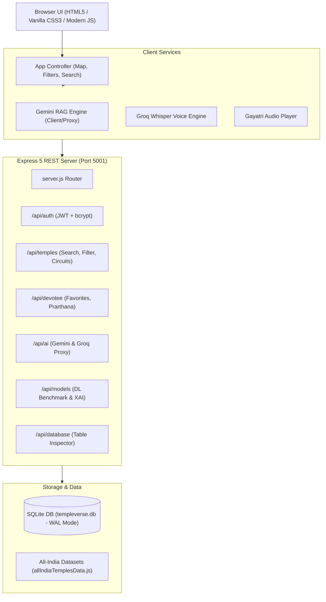

# 🕉️ TempleVerse — Sacred Sanctum & AI Pilgrimage Platform

<div align="center">


<br/>

[](https://nodejs.org/)
[](https://expressjs.com/)
[](https://sqlite.org/)
[](https://ai.google.dev/)
[](https://groq.com/)
[](LICENSE)
[](CONTRIBUTING.md)

<p align="center">
  <b>A comprehensive, AI-powered interactive digital sanctum for exploring 200+ sacred shrines across North & South India.</b><br/>
  Featuring precision GIS mapping, intent-gated RAG intelligence, speech recognition, Hindu Panchangam, deep learning architectural classification, and personalized devotee vows.
</p>

[Explore Features](#-key-features) • [Quick Start](#-quick-start) • [Architecture](#-system-architecture) • [API Documentation](#-rest-api-reference) • [Data Inspector](#-backend-data-inspector) • [Tech Stack](#-tech-stack)

</div>

---

## 📖 Table of Contents

- [Overview](#-overview)
- [Key Features](#-key-features)
- [System Architecture](#-system-architecture)
- [Tech Stack](#-tech-stack)
- [Repository Structure](#-repository-structure)
- [Quick Start & Setup](#-quick-start--setup)
- [Environment Configuration](#-environment-configuration)
- [REST API Reference](#-rest-api-reference)
- [Backend Data Inspector](#-backend-data-inspector)
- [AI Sanctum Engine & Strict Intent Gating](#-ai-sanctum-engine--strict-intent-gating)
- [Deep Learning & XAI Heritage Models](#-deep-learning--xai-heritage-models)
- [Contributing](#-contributing)
- [License](#-license)

---

## 🌟 Overview

**TempleVerse** is an all-in-one digital spiritual sanctum created to preserve, celebrate, and provide verified guidance on **India's ancient temple heritage**. 

Bridging ancient Vedic traditions with state-of-the-art web and AI technologies, TempleVerse features an interactive SVG map with 200 historically verified shrines, a Retrieval-Augmented Generation (RAG) AI assistant powered by Google Gemini, natural voice queries through Groq Whisper, authentic daily Panchangam calculations, 3D architectural exploration, and deep learning architectural classification with explainable AI (Grad-CAM saliency maps).

Devotees can explore pilgrimage circuits (12 Jyotirlingas, Char Dham, Pancha Bhoota, Shakti Peethas), register personal prayer vows (*Prarthanas*), bookmark shrines, and search temples by specific ailments or blessing intentions with strict intent isolation.

---

## 🚀 Key Features

### 1. 🗺️ High-Precision All-India Interactive GIS Map
- **200 Verified Shrines**: Spanning North and South India across 28 states and union territories.
- **Geographic Precision**: Shrines are locked to verified coordinates with border-snapping algorithms to ensure icons stay strictly within state borders.
- **Interactive State Drilling**: Click on any state to zoom in, isolate regional shrines, and view state heritage summaries.
- **Smart Filtering**: Filter shrines instantly by Presiding Deity, Pilgrimage Circuit, Region (North vs. South), or specific Blessing/Healing domain.

### 2. 🕉️ Grounded AI Sanctum Assistant (Gemini RAG Engine)
- **Zero-Hallucination Verified RAG**: Powered by Google Gemini (`gemini-1.5-flash`, `gemini-2.0-flash`, `gemini-1.5-pro`) grounded strictly in the 200-temple verified knowledge base.
- **Strict Intent Gating**: Custom gating architecture guarantees queries for specific blessings (e.g., *Visa*, *Marriage*, *Child Wellness*, *Education*, *Wealth*) or medical concerns (*Skin*, *Neurological/Autism*, *Kidney*, *Bone/Joint*, *Eye*, *Respiratory*) return **strictly matching shrines** without low-relevance filler padding.
- **Aspect-Specific Follow-Up Intelligence**: Seamless multi-turn conversation memory for instant deep dives on:
  - 🪔 *Darshan Timings & Daily Seva Schedules*
  - 🏛️ *Historical Origins & Architectural Era*
  - 🌺 *Sacred Beliefs, Vows & Sthala Puranam*
  - 🚗 *How to Reach, Nearest Airport & Railway Junctions*
  - 📋 *Dress Codes, Footwear Rules & Prasadam Guidelines*

### 3. 🎙️ Natural Voice Commands (Groq Whisper)
- High-speed voice search using Groq's `whisper-large-v3-turbo` model.
- Tuned for Indian English phonetics and Sanskrit/Hindi devotional terms (*"Chilkur Balaji"*, *"Jyotirlinga"*, *"Pradosham"*, *"Vaitheeswaran Koil"*).

### 4. 🔬 Deep Learning Architecture Benchmark & XAI
- Benchmarking 3 SOTA computer vision architectures trained on the **Bharat Heritage Architecture Dataset (BHAD-12K)**:
  - **ResNet-50** *(⚡ Ultra-low latency: 21.4ms)*
  - **EfficientNet-B4** *(⚖️ Balanced efficiency: 95.8% Top-1 Accuracy)*
  - **Vision Transformer (ViT-Base/16)** *(🏆 Supreme fidelity: 96.7% Top-1 Accuracy)*
- **Explainable AI (XAI)**: Grad-CAM attention heatmaps revealing what structural features (Shikhara, Gopuram, Vimana, Mandapa, Kalasha) drove the model's classification.

### 5. 📅 Vedic Hindu Panchangam Engine
- Real-time astronomical calculations:
  - **Tithi** (Lunar Day) & **Paksha** (Shukla / Krishna)
  - **Nakshatra** (Birth Star) & **Yoga**
  - **Karanam**
  - **Auspicious & Inauspicious Muhurats**: Rahu Kalam, Yamagandam, Gulika Kalam, Abhijit Muhurat.

### 6. 🏛️ 3D Architectural Anatomy Explorer
- Interactive 3D structural breakdowns of Dravidian (South) and Nagara (North) temple architectural orders:
  - *Gopuram* (Towering Gateway)
  - *Vimana* (Sanctum Superstructure)
  - *Garbhagriha* (Inner Sanctum Sanctorum)
  - *Mandapam* (Pillared Assembly Hall)
  - *Dhwajastambha* (Sacred Flagstaff)

### 7. 👤 Devotee Sanctum & SQLite Persistence
- Devotee account registration & JWT session management.
- Personal Bookmarks & Favorites.
- Digital *Prarthana* Ledger: Register prayer vows (*Mannats*) with tracking categories (*Health, Family, Education, Peace*).
- High-performance SQLite engine operating in Write-Ahead Logging (`WAL`) mode.

### 8. 💾 Interactive Backend Data Inspector
- Built-in web dashboard at `/data-viewer.html` for real-time browsing of all SQLite tables (`temples`, `users`, `prarthanas`, `favorites`).
- One-click export to **CSV** and **JSON**.
- Full payload JSON drawer for inspectable temple metadata.

---

## 🏗️ System Architecture



---

## 💻 Tech Stack

| Domain | Technology | Purpose |
| :--- | :--- | :--- |
| **Frontend** | Vanilla JavaScript (ES2022+), HTML5, CSS3 | Zero-dependency, ultra-fast client with gold sanctum theme |
| **Maps & GIS** | Dynamic SVG Vector Maps (`@svg-maps/india`) | Responsive, interactive, zoomable state & shrine visualization |
| **Backend Framework** | Node.js (v18+) with Express 5 | High-throughput REST API with CORS & static asset streaming |
| **Database** | SQLite with `better-sqlite3` | Zero-config, single-file relational database in WAL mode |
| **Authentication** | JSON Web Tokens (`jsonwebtoken`) & `bcryptjs` | Secure stateless auth with salted password hashing |
| **Generative AI** | Google Gemini (`gemini-1.5-flash`, `gemini-2.0-flash`) | Grounded RAG knowledge synthesis & conversational memory |
| **Speech AI** | Groq Whisper API (`whisper-large-v3-turbo`) | Low-latency voice search transcription |
| **Computer Vision** | ResNet-50, EfficientNet-B4, Vision Transformer | Architectural heritage classification & Grad-CAM XAI |
| **Fonts & Icons** | Google Fonts (*Cinzel*, *Inter*, *JetBrains Mono*) | Classical aesthetic typography |

---

## 📁 Repository Structure

```
temple-project/
├── prototype 4/                       # Main application workspace
│   ├── server.js                      # Express 5 backend server & router
│   ├── database.js                    # SQLite connection, schema & seed engine
│   ├── templeverse.db                 # SQLite database file (WAL mode)
│   ├── index.html                     # Main interactive Single Page Application
│   ├── data-viewer.html               # Backend Data Inspector & Table Explorer
│   ├── style.css                      # Sacred Dark Sanctum CSS & Vedic Kolam styling
│   ├── app.js                         # Front-end map, search, filter & UI logic
│   ├── geminiService.js               # Google Gemini RAG assistant & Intent Gating
│   ├── groqService.js                 # Groq Whisper voice recognition service
│   ├── authService.js                 # Client-side user auth state management
│   ├── config.js                      # Client API keys and service configurations
│   ├── allIndiaTemplesData.js         # Complete verified dataset (200 Shrines)
│   ├── northIndiaTemplesData.js       # Synchronized Northern dataset
│   ├── package.json                   # Dependencies and npm script definitions
│   ├── .env                           # Environment variables & API credentials
│   ├── assets/                        # Audio files (Gayatri Mantram) & icons
│   ├── middleware/                    # JWT authentication middleware
│   │   └── authMiddleware.js
│   └── routes/                        # Express API route modules
│       ├── authRoutes.js              # Devotee registration & sign-in
│       ├── templeRoutes.js            # Temples, circuits & geographic queries
│       ├── devoteeRoutes.js           # Prayer vows & bookmark management
│       ├── aiRoutes.js                # Gemini & Groq proxy handlers
│       └── modelRoutes.js             # DL classification benchmark & XAI
├── south_temple/                      # Raw South India temple datasets & records
├── North_India_Temples_Updated.xlsx   # Source reference spreadsheet for North shrines
├── build_all_temples.py               # Data merging & pipeline synchronization script
└── README.md                          # Project documentation
```

---

## ⚡ Quick Start & Setup

### Prerequisites
- **Node.js**: `v18.0.0` or higher installed ([Download Node.js](https://nodejs.org/))
- **npm**: `v9.0.0` or higher

### 1. Clone the Repository
```bash
git clone https://github.com/your-username/templeverse.git
cd templeverse
```

### 2. Install Backend Dependencies
```bash
cd "prototype 4"
npm install
```

### 3. Configure Environment Variables
Create or verify your `.env` file inside `prototype 4/.env`:
```env
PORT=5001
NODE_ENV=development
JWT_SECRET=templeverse_sacred_sanctum_jwt_secret_key_108
GEMINI_API_KEY=your_google_gemini_api_key_here
GROQ_API_KEY=your_groq_api_key_here
```

### 4. Start the Application
```bash
npm start
```
*Or run directly:*
```bash
node server.js
```

### 5. Access the Platform
- 🌐 **Interactive Map & Sanctum UI**: [http://localhost:5001](http://localhost:5001)
- 💾 **Backend Data Inspector**: [http://localhost:5001/data-viewer.html](http://localhost:5001/data-viewer.html)
- 📡 **Server Health Endpoint**: [http://localhost:5001/api/health](http://localhost:5001/api/health)

---

## 📡 REST API Reference

### Devotee Authentication (`/api/auth`)
| Method | Endpoint | Description | Auth Required |
| :--- | :--- | :--- | :---: |
| `POST` | `/api/auth/signup` | Register a new devotee account | No |
| `POST` | `/api/auth/signin` | Devotee sign-in & JWT generation | No |
| `GET` | `/api/auth/me` | Retrieve profile and stats for logged-in devotee | **Yes** (Bearer Token) |
| `PUT` | `/api/auth/profile` | Update profile name, state preference, or avatar | **Yes** (Bearer Token) |

> **Sample Devotee Credentials for Testing:**  
> Email: `pilgrim@templeverse.com`  
> Password: `temple108`

### Temples & Circuits (`/api/temples`)
| Method | Endpoint | Query Params / Description |
| :--- | :--- | :--- |
| `GET` | `/api/temples` | `?state=IN-TN`, `?deity=Shiva`, `?q=visa`, `?limit=50&offset=0` |
| `GET` | `/api/temples/summary` | Shrine distribution statistics grouped by state |
| `GET` | `/api/temples/circuits/:circuitKey` | Curated circuits (`jyotirlinga`, `chardham`, `panchabhoota`, `visa`) |
| `GET` | `/api/temples/:id` | Full shrine dossier (history, rituals, timings, architecture) |

### Devotee Vows & Bookmarks (`/api/devotee`)
| Method | Endpoint | Description | Auth Required |
| :--- | :--- | :--- | :---: |
| `GET` | `/api/devotee/favorites` | List all saved bookmarks of current devotee | **Yes** |
| `POST` | `/api/devotee/favorites` | Add shrine to favorites | **Yes** |
| `DELETE` | `/api/devotee/favorites/:templeId` | Remove shrine from favorites | **Yes** |
| `GET` | `/api/devotee/prarthana` | Retrieve registered prayer vows (*Mannats*) | **Yes** |
| `POST` | `/api/devotee/prarthana` | Submit a new sacred prayer intention | **Yes** |

### Database Inspector (`/api/database`)
| Method | Endpoint | Description |
| :--- | :--- | :--- |
| `GET` | `/api/database/tables` | Returns row counts for all SQLite tables |
| `GET` | `/api/database/table/:name` | Paginated records from `temples`, `users`, `prarthanas`, or `favorites` |

---

## 💾 Backend Data Inspector

TempleVerse features an integrated **Data Inspector** available at:
`http://localhost:5001/data-viewer.html`

- **Visual Table Explorer**: View and search all tables without needing third-party database software.
- **Dynamic Stats Bar**: Real-time counter of total shrines (200), devotees (2), prayers (1), and bookmarks (1).
- **Inspect Drawer**: Click "Inspect" on any shrine to view its unformatted JSON document (including sthala puranam, timings, and coordinates).
- **Data Export**: One-click **Export CSV** and **Export JSON** for local analysis.

---

## 🎯 AI Sanctum Engine & Strict Intent Gating

Unlike conventional keyword search or ungoverned LLM responses, TempleVerse implements **Strict Intent Gating** in both the frontend search engine and the Gemini RAG service:

```
User Query: "temples related to visa"
  │
  ├── 1. Intent Detection
  │      Detects: blessing:visa
  │
  ├── 2. Strict Filter Gate
  │      Disqualifies all shrines lacking the Visa tag (Score = 0)
  │      Excludes generic health, skin, and astrology shrines
  │
  └── 3. Verified Result
         Returns strictly: Chilkur Balaji Temple (Visa Balaji) [1 match, 0 noise]
```

### Supported Specific Intent Taxonomies:
- **Blessings**: `Visa & Foreign Travel`, `Marriage & Matrimony`, `Child Wellness & Santana Gopala`, `Education & Vidya`, `Wealth & Prosperity`.
- **Health & Ailments**: `Skin & Dermatology`, `Neurological, Psychiatric & Autism`, `Kidney & Urinary`, `Paralysis, Bone, Spine & Joint`, `Respiratory & Asthma`, `Heart & Blood Pressure`, `Diabetes & Metabolism`, `Eye & Vision`, `Throat, Speech & Thyroid`, `Digestive & Liver`.

---

## 🔬 Deep Learning & XAI Heritage Models

The `/api/models` endpoint exposes experimental benchmark data on Indian temple architectural classification across four historical styles:
1. **Dravidian** (Tamil Nadu, Karnataka, Kerala, Andhra Pradesh)
2. **Nagara** (North India, Odisha, Gujarat, Rajasthan)
3. **Vesara** (Deccan hybrid, Chalukya, Hoysala)
4. **Kalinga** (Odisha Jagannath & Konark style)

### Model Benchmark Summary:
| Model Architecture | Parameters | FLOPs | Latency | Top-1 Accuracy | Top-5 Accuracy |
| :--- | :---: | :---: | :---: | :---: | :---: |
| **ResNet-50** | 25.6M | 4.1 GFLOPs | **21.4 ms** | 93.4% | 98.6% |
| **EfficientNet-B4** | 19.3M | 4.5 GFLOPs | 34.2 ms | 95.8% | 99.1% |
| **Vision Transformer (ViT-Base/16)** | 86.6M | 17.6 GFLOPs | 58.7 ms | **96.7%** | **99.5%** |

---

## 🤝 Contributing

Contributions to expand temple datasets, improve architectural 3D models, or enhance multilingual Panchangam calculations are warmly welcomed!

1. Fork the Project
2. Create your Feature Branch (`git checkout -b feature/NewShrineData`)
3. Commit your Changes (`git commit -m 'Add Kanchi Kamakshi verified temple dossier'`)
4. Push to the Branch (`git push origin feature/NewShrineData`)
5. Open a Pull Request

---

## 📄 License

Distributed under the **MIT License**. See `LICENSE` for more information.

---

<div align="center">
  <sub>Built with devotion & engineering rigor for Bharat's timeless heritage.</sub><br/>
  <b>🕉️ Har Har Mahadev • Jai Shree Krishna • Jai Shree Ram 🕉️</b>
</div>
